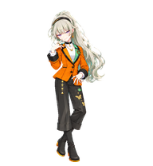

[← 返回宠物合集](../README.md)

# 宁宁 · 橙纹西装

**宁宁 · 橙纹西装** · ID `nene_herringbone_suit` · 9种动画 · 16个注视方向

- **服饰要素**：灰绿高马尾、金铆钉黑发箍、金绿不对称耳饰；橙色人字纹两扣西装、黑滚边与袖口、单侧绿翻领和徽章；白色高领内衫、黑颈圈、金项链及戒指；黑色翻边宽裤、金链与蝴蝶刺绣，配金橙底缘黑色圆头长靴。
- **画风**：日系舞台插画，采用修长比例（约4.5～5头身）；锐利半眯眼、不对称笑意、错肩站姿与唇边指尖手势，表现原卡的狂气与从容。
- **参考卡面**：4星「森の導き手」特训后；原色衣装「Acting ambition」。

## 动画与下载

[动画总览](preview/animation-overview.gif) · [十六方向](preview/look-directions.gif) · [全部预览](preview/README.md) · [静态全帧](preview/contact-sheet.png)

导入文件：[pet.json](pet.json) · [spritesheet.webp](spritesheet.webp)。

[下载 v2.0.0 十九套合集](https://github.com/scenesuki/nene_codex_pets/releases/download/v2.0.0/nene_codex_pets-v2.0.0.zip) · [SHA-256 校验和](https://github.com/scenesuki/nene_codex_pets/releases/download/v2.0.0/SHA256SUMS.txt)。本套已收录于该版本；历史名称见[命名对照](../PET_NAMES.md)。

## 安装

1. 将 `nene_herringbone_suit/` 复制至 `~/.codex/pets/`，保留顶层两个导入文件。
2. Windows 默认目录为 `%USERPROFILE%\.codex\pets\nene_herringbone_suit\`；自定义 `CODEX_HOME` 时使用其下的 `pets/nene_herringbone_suit/`。
3. 在 **Codex 设置 > Pets** 中刷新并选择「宁宁 · 橙纹西装」，必要时重启应用。

规格与验收

**验证范围**：文件及预览检查已有记录；Codex 设置识别、桌面浮动显示与应用内动态播放尚未实测。兼容依据和已知限制如下。

- Codex原生v2，无损RGBA WebP，1536×2288、8列11行、单格192×208，`spriteVersionNumber: 2`。
- [应用规格依据](preview/app-contract-verification.json)：2026-10-22只读核对Codex 26.1016.6573.0实际安装包的加载与渲染代码。
- 九状态：待机、向右慢走、向左慢走、招手、原地戏谑、失落、等待回应、专注处理中、审视；帧数6/8/8/4/5/8/6/6/6。
- [本次动作验收](preview/motion-revision-validation.json)：左右移动统一为低抬脚、小步幅、自然摆臂的普通慢走；原跳跃状态为原地戏谑动作，保留应用状态名 `jumping` 以兼容格式。其余六组动作与十六方向逐像素保留。
- 从各行原始生成图裁切，同行统一缩放、稳定脚底基线；原跳跃状态改为侧头轻笑与唇边指尖轻勾，支撑脚固定、无腾空，五帧均不施加离地位移，见[动作定位记录](preview/standard-registration.json)。左右移动分别生成，保留单侧翻领与裤饰。
- 左右行走共用应用原生节拍（前七帧120ms、末帧220ms，一圈1060ms），通过小步幅、低抬脚和较小帧间位移形成舒缓走路观感；未修改应用播放速度或人物移动速度，见[实际播放映射](preview/animation-timing-verification.json)。
- 注视从000°正上方开始，每22.5°顺时针变化；090°屏幕右、180°下、270°屏幕左，见[实际映射依据](preview/current-look-runtime-verification.json)。四基准方向、两行逐方向和跨行连续性均经检查。
- 注视定位直接使用待机首帧几何，保持脚底基线一致；第二行复用第一行已批准变换。
- [图集校验](validation.json)、[标准动作验收](preview/standard-visual-qa.json)、[最终视觉验收](preview/final-visual-qa.json)、[方向盲审](preview/direction-blind-validation.json)、[逐方向语义](preview/direction-semantics.json)与[连续性](preview/look-continuity.json)记录实际检查结果。
- 已接受的细微限制：部分相邻注视方向接近，靠近正下方的横向视线较弱；修长比例下嘴角与手指动作较细。
- [加载算法检查](preview/app-loader-validation.json)重放当前应用实际图片、版本及路径验证函数；[预览文件检查](preview/preview-files-check.json)逐帧解码全部GIF，静态小图逐像素来自待机首帧。

- 制作时的 [README 排版检查](preview/readme-layout-check.json)记录桌面与窄屏检查结果。

参考与制作记录

- [SEGA官方公告：卡面与衣装对应](https://prtimes.jp/main/html/rd/p/000007586.000005397.html)
- [原色全身模型与配饰](https://game8.jp/pjsekai/808589)
- [高清完整特训后卡面](https://pjsekai.gamedbs.jp/chara/show/7/1425)
- [官方角色资料](https://pjsekai.sega.jp/character/unite04/nene/index.html)

已核对完整特训后卡面与原色全身模型。下半身为两腿分开的翻边宽裤及长靴，金链、刺绣和鞋底色缘均有全身资料依据。发型采用特训后卡面的高马尾，衣装采用原色模型配色；未使用模型默认披发，也未把蓝绿环境光作为白衬衫固有色。鸟、水母和泡泡属于场景，本套不作固定道具。

「橙纹西装」为本项目按服饰特点起的名称，非官方译名。依据本卡图像的锐利目光、嘴角笑意和唇边手势设计狂气舞台演绎，转化为带笑待机、挑逗式指尖招手、双向自然慢走、节奏鲜明的手部处理与俯身审视；这些动作属于本卡舞台角色的创作演绎，不代表宁宁日常性格总是如此。

制作沿用本套既有处理流程，未借用其他宠物的角色图片。角色与动画使用 ImageGen 制作，图集经分格、定位和组装导出。制作原素材不随仓库或安装包分发；安装以本页列出的两个导入文件为准。权利说明见 [NOTICE.md](NOTICE.md)。

